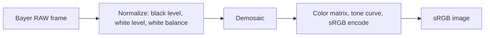

# Project goal

## Goal

Build an open-source library that converts RAW camera sensor data into a finished photo on the Apple silicon GPU. Every processing step is a hand-written Metal compute kernel. Each step is measured for correctness, speed against the GPU's measured limits, and speed against Apple's own RAW pipeline.

The lab is aimed at ML engineer and ML systems engineer roles built around GPU kernels, especially camera and imaging roles.

## Target hardware

| Item | Value |
|---|---|
| Chip | Apple M4, 10-core GPU, 16 GB unified memory |
| Software | macOS 27, Xcode 27.1, Metal 4 |
| Memory bandwidth | 120 GB/s published by Apple. T03 measures the real ceiling. |

## Pipeline

v0.1 builds these three stages. v0.2 adds a learned denoiser between Normalize and Demosaic.

## Milestones

| Milestone | Result | Due |
|---|---|---|
| **v0.1 Classical pipeline** | Three ISP kernels turn a 12 MP Bayer frame into an sRGB image. Timed, checked against library references, and compared with Apple's `CIRAWFilter`. | 2026-12-07 |
| v0.2 Learned denoiser | Small CNN trained in PyTorch on SIDD. Inference runs on hand-written Metal convolution kernels: naive, then tiled, then `simdgroup_matrix`. Compared with Core ML and MPSGraph on the same weights. | Set after v0.1 |
| v0.3 Library release | Swift package, Core Image wrapper (`CIImageProcessorKernel`), iOS build, API documentation. | Set after v0.2 |
| v0.4 Characterization | Compute ceiling and roofline report, threadgroup size sweeps, test matrix (ISO, scenes, thermal state), regression check, sensor noise characterization, CI on a self-hosted runner. | Set after v0.3 |

## v0.1 plan

| Task | Dates | Done when |
|---|---|---|
| T01 Build | Nov 22–24 | `cmake -B build && cmake --build build` produces `libce`, `ce` and `build/kernels.metallib` with zero warnings under `-Wall -Wextra -Werror`. `ce` prints the GPU name. |
| T02 GPU harness and timing | Nov 25–27 | A copy kernel runs through the harness and matches its input exactly for sizes 1, 1023, 2^20, and a size that is not a multiple of the threadgroup size. Timing reports the median of N runs after warm-up. Three runs of a 256 MB copy give medians within 5% of each other. |
| T03 Bandwidth ceiling | Nov 28 | A `float4` copy kernel sweeps 1 MB to 512 MB. Peak GB/s is saved in `results/device.json` next to Apple's 120 GB/s. |
| T04 Test data and references | Nov 25–29 | A 12 MP Bayer RAW file with a checked license is in `data/` (not committed). A Python script exports its Bayer plane and metadata (black level, white level, white balance gains, color matrix, CFA pattern). `uv run pytest` runs `ce` on the exported data and compares the result with a library reference. |
| T05 Normalize kernel | Nov 30 | Matches the NumPy reference within the documented fp32 tolerance. Achieved GB/s reported. |
| T06 Demosaic kernel | Dec 1–2 | Bilinear demosaic matches `colour-demosaicing` within the documented tolerance. Achieved GB/s reported. |
| T07 Color and tone kernel | Dec 3 | 3×3 color matrix and sRGB encoding match `colour-science` within the documented tolerance. Achieved GB/s reported. |
| T08 Pipeline, benchmark and baseline | Dec 4–5 | `ce run` chains the three stages in one command buffer. `ce bench` writes per-stage and total GPU time, GB/s and % of ceiling to a results JSON with chip, OS and commit. A Swift script times `CIRAWFilter` on the same file with lens correction and noise reduction off. |
| Release | Dec 6–7 | README shows the results table. `develop` is promoted to `main` and tagged `v0.1`. |

Each kernel task (T05–T07) starts with pseudocode reviewed before the Metal code is written.

**Checkpoint on Nov 29:** T01–T03 are merged. If they are not, apply the cuts below in order.

**Cuts, in order:**
1. T03 measures one buffer size (256 MB) instead of a sweep.
2. T07 uses a gamma curve instead of the exact sRGB function.
3. The README table drops the per-stage % of ceiling and keeps total time against `CIRAWFilter`.

## v0.1 success criteria

| # | Criterion | Target | Verified by |
|---|---|---|---|
| S1 | Each stage matches its library reference | Within documented fp32 tolerance | `uv run pytest` |
| S2 | Full pipeline GPU time on a 12 MP frame | ≤ 33 ms (30 fps), median of 20 runs | `ce bench` |
| S3 | Memory-bound stages use the memory system well | Each stage ≥ 50% of measured bandwidth. Stretch: ≥ 70%. | `ce bench` |
| S4 | Apple's pipeline is measured on the same input | `CIRAWFilter` GPU time reported next to S2, same file and output size | Baseline script |
| S5 | Results are reproducible | One command regenerates the README results table and records chip, OS and commit | T08 |

## Library design rules

These apply from T01 so the v0.3 release needs no rework.

1. `libce` holds all GPU code. `ce` is a thin command-line program that calls `libce`.
2. `libce` uses the caller's `MTLDevice` and encodes into the caller's `MTLCommandBuffer`. It never commits or waits on a command buffer it did not create.
3. `libce` reads and writes buffers the caller provides, without copying them.
4. Each stage can be called on its own. A pipeline object chains them.
5. The caller supplies the Bayer data and its metadata. Decoding RAW files stays outside the library.

## Data and baselines

**Data** (not committed):
- **v0.1:** one 12 MP Bayer RAW file, for example from raw.pixls.us. iPhone ProRAW files are already demosaiced, so they cannot be used as Bayer input.
- **v0.2:** SIDD (Smartphone Image Denoising Dataset), noisy and clean pairs in raw.

**References.** Each algorithm is implemented once, as a Metal kernel. References come from libraries:

| Stage | Reference |
|---|---|
| RAW decoding and metadata | `rawpy` (LibRaw) |
| Normalize | NumPy |
| Demosaic | `colour-demosaicing` |
| Color matrix and sRGB encoding | `colour-science` |
| Convolution layers (v0.2) | PyTorch, saved as golden files |

**Baselines:**
- Apple's `CIRAWFilter` (Core Image) for the full pipeline, timed with `CIRenderInfo.kernelExecutionTime`.
- Core ML and MPSGraph running the same denoiser weights (v0.2).

## Non-goals

- No camera app, live capture or UI.
- No CUDA. GPU code is Metal Shading Language with metal-cpp host code. Python is used only for training, data export, references and reports.
- No attempt to match the image quality of a shipping camera pipeline. Comparisons with Apple's software are measurements.
- No large models. The denoiser trains on this Mac.
- No RAW file decoding inside the library.

## Engineering process

Changes flow `feature branch → develop → main`:

- **`main`:** released milestones only. Updated only by a PR from `develop`, then tagged.
- **`develop`:** the integration branch. Every task PR targets it.
- **Task branches:** `<type>/<issue>-<slug>`, for example `feat/1-build`. Types: `feat`, `fix`, `docs`, `test`, `perf`, `chore`.

Each task is one GitHub issue with a goal and a done-when checklist. Design notes go in the PR description.

Before a PR into `develop` merges:
1. The build passes with warnings as errors, and `clang-format --dry-run --Werror` passes.
2. `uv run pytest` passes.
3. An AI review (Claude Code `/code-review` or Codex) has run. Every finding is fixed or answered.

GPU tests and benchmarks run on this Mac, because timings are only comparable on the same machine. CI on a self-hosted runner arrives in v0.4.
