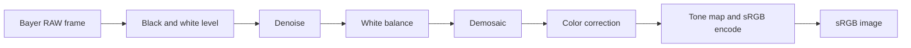

# Project goal

## Goal

Build a RAW camera pipeline for Apple silicon from hand-written Metal compute kernels. Then measure it the way a camera hardware team measures a component: image quality, speed against the hardware's measured limits, and results that hold across a test matrix.

The pipeline turns a Bayer RAW frame from an image sensor into a display-ready sRGB image. It has two kinds of stages:

- **Classical ISP stages:** black level, white balance, demosaic, color correction and tone mapping. These are memory-bound and teach bandwidth-limited kernel design.
- **A learned raw denoiser:** a small convolutional network trained in PyTorch. Its inference runs on hand-written convolution kernels, which are compute-bound and teach the GPU matrix hardware (`simdgroup_matrix`) and fp16 numerics.

Together the two kinds cover both sides of the roofline on one GPU.

## Why

The lab is aimed at ML engineer and ML systems engineer roles built around GPU kernels, especially camera and imaging roles. Those roles ask for:

| Role requirement | Where the lab shows it |
|---|---|
| Camera ISP pipeline | Every classical stage written from scratch as a Metal kernel |
| Image sensor technology | Bayer CFA handling, black and white levels, sensor noise characterization (shot and read noise) |
| Deep learning for computer vision | Learned raw denoiser trained in PyTorch |
| Image quality metrics and evaluation method | PSNR, SSIM and ΔE2000, validated against reference libraries, with a written method |
| Benchmarking and characterization | Timing harness, measured bandwidth and compute ceilings, roofline placement for every kernel |
| GPU kernel engineering | Metal Shading Language kernels, simdgroup reductions, `simdgroup_matrix` convolutions |

The lab uses Metal instead of CUDA because development happens on an Apple silicon Mac.

## Target hardware

| Item | Value |
|---|---|
| Chip | Apple M4, 10-core GPU, 16 GB unified memory |
| Software | macOS 27, Xcode 27.1, Metal 4 |
| Memory bandwidth | 120 GB/s published by Apple. T06 measures the real ceiling. |

## Pipeline

The denoise stage has two variants: a classical baseline and the learned denoiser. The learned denoiser runs on the packed RGGB raw (four half-resolution channels) before demosaic.

## Success criteria

Targets marked *provisional* come from first estimates. The research phase confirms or revises them before design starts.

| # | Criterion | Target | Verified by |
|---|---|---|---|
| S1 | Every stage matches a CPU or Python reference | Within documented fp32 and fp16 tolerances | `ctest` (T05 gate) |
| S2 | Classical pipeline speed on a 12 MP (4032×3024) frame | ≤ 33 ms GPU time (30 fps). Stretch: ≤ 16 ms (*provisional*) | Timing harness (T04) |
| S3 | Memory-bound stages use the memory system well | Each stage reaches ≥ 70% of measured bandwidth (*provisional*) | Roofline report (T11) |
| S4 | Learned denoiser is correct on Metal | Output matches PyTorch on the same weights within documented fp16 tolerance | `ctest` |
| S5 | Learned denoiser improves image quality | Higher PSNR and SSIM than the classical denoiser on the SIDD validation split. Margin set in research. | IQ evaluation |
| S6 | Learned denoiser speed holds up against Apple's stack | Within 2× of Core ML (GPU compute units) and MPSGraph running the same weights (*provisional*) | Benchmark suite |
| S7 | Image quality metrics are trustworthy | PSNR, SSIM and ΔE2000 match scikit-image and colour-science within documented tolerance | `ctest` |
| S8 | Sensor noise is characterized | Shot and read noise fitted per Bayer channel from raw data. Agreement with the capture's stored noise profile reported where one exists. | Characterization report |
| S9 | Results qualify across conditions | S1 to S7 hold across the qualification matrix: ISO levels, scenes, frame sizes, cold and sustained thermal state | Qualification report |
| S10 | Results are reproducible | One command regenerates every number in the report from a commit, recording chip, OS and commit | `ce suite` (T12) |

### Stop and rethink

- After optimization, a memory-bound stage still below 50% of measured bandwidth needs a written analysis before the next milestone starts.
- The denoiser is trained and evaluated in PyTorch before any inference kernel is written. If it does not beat the classical denoiser there, fix the model before writing kernels.

## Phases

| Phase | Output | Gate to the next phase |
|---|---|---|
| Research | Notes in `docs/research/`: ISP stages, sensor noise models (EMVA 1288), datasets, Apple GPU architecture, baselines. Final values for every provisional target. | Targets fixed. Datasets downloaded and licenses checked. |
| Design | Design docs for each task (sub-issues X.1 to X.5) | Design sub-issues closed |
| Development | Kernels and host code on feature branches | CI green and PR merged into `develop` |
| Test | Correctness, image quality and benchmark results | S1 to S8 pass on `develop` |
| Qualification | Qualification report across the test matrix | S9 passes. `develop` promoted to `main` and tagged. |

Research runs once, at the start. Design, development and test repeat for each task. Qualification runs for each release.

## Data and baselines

**Data** (not committed to the repo):
- **SIDD** (Smartphone Image Denoising Dataset): noisy and clean image pairs in raw and sRGB, across ISO levels and lighting. Used to train and evaluate the denoiser.
- **Own Bayer DNG captures:** used for end-to-end pipeline tests and for flat-field noise characterization.

**Baselines:**
- `rawpy` (LibRaw): reference RAW decoding and processing.
- Core Image `CIRAWFilter`: Apple's RAW pipeline, used for the end-to-end comparison.
- Core ML and MPSGraph: run the same denoiser weights.
- PyTorch (MPS backend): training and numerical reference.

## Non-goals

- No camera app, live capture or UI.
- No CUDA. GPU code is Metal Shading Language with metal-cpp host code. Python is only for training, references and reports.
- No attempt to match the image quality of a shipping camera pipeline. Comparisons with Apple's software stack are measurements, not targets.
- No large models. The denoiser trains on this Mac.
- No optics, lens or sensor hardware design.

## Engineering process

Changes flow `feature branch → develop → main`:

- **`main`:** only code that passed qualification. Updated only by a PR from `develop`.
- **`develop`:** the integration branch. Every feature PR targets it.
- **Feature branches:** `<type>/<issue>-<slug>`, for example `docs/2-project-goal` or `feat/8-cmake-skeleton`. Types: `feat`, `fix`, `docs`, `test`, `perf`, `chore`.

Every PR into `develop` passes, in order:
1. CI: build with warnings as errors, `clang-format` check, `clang-tidy`, CPU-side unit tests.
2. AI review: an automated reviewer (Claude Code, Codex) comments on the PR. Every finding is either fixed or answered before merge.
3. Merge by the owner.

A promotion from `develop` to `main` requires:
1. The full suite on this Mac: GPU correctness, image quality, and benchmarks with the regression check (T13).
2. A PR from `develop` to `main` with the suite results attached.

GPU tests and benchmarks run locally, or on a self-hosted runner on this Mac. There are two reasons. GitHub-hosted macOS runners can't be relied on for GPU access, and timings are only comparable on the same machine.

Status: the branch layout exists. CI and AI review get set up in their own task.

## Roadmap impact

M0 Foundation, M1 Harness, M2 Memory bandwidth, M5 Characterization and M6 Complete program carry over. M3 (FP16 matvec) and M4 (Quantized matvec) target LLM decoding and do not serve this goal. Proposed changes:

| Milestone | Change |
|---|---|
| R0 Research | New. Runs alongside M0. |
| M3 | Replaced by **Classical ISP kernels** |
| M4 | Replaced by **Learned raw denoiser**: PyTorch training, convolution kernels, Core ML and MPSGraph comparison |
| M5 | Adds image quality metrics and sensor noise characterization |
| M7 Qualification | New. Test matrix and qualification report. |

Issues change after this goal is accepted.
